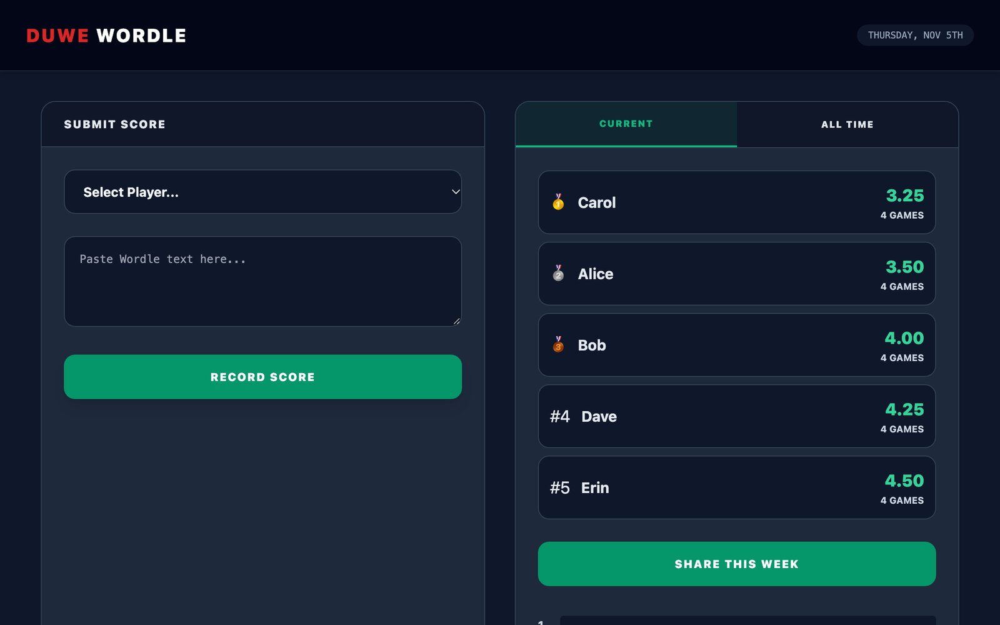

# Wordle Tracker

A small, self-hosted scoreboard for a group of friends or family playing [Wordle](https://www.nytimes.com/games/wordle/). Paste your Wordle share text, and it records your score and keeps the leaderboards up to date.

It's plain PHP and MySQL, with no build step and no Composer dependencies.



The players and scores in this screenshot are made up.

## Features

- **Paste to record:** pick a player and paste the share text. The date comes from the puzzle number, so a late entry still lands on the right day.
- **Leaderboards:** current week and all-time averages, with medals, games played and score distribution.
- **Yearly stats:** a monthly chart, annual rankings, year-on-year trends and each player's best and worst day of the week.
- **Smart sharing:** builds a leaderboard message for your group chat, and adds week, month and year finals on the days those periods end.
- **Recent boards:** shows the latest 24 boards as emoji grids, which you can reassign to another player or delete.
- **Overwrite warning:** asks before replacing a score that player already has for that day.
- **Quick links:** opening `index.php?wordle=<share text>` fills in the form and asks you to confirm.
- **Dropbox backups:** a command-line script uploads a restorable SQL dump.

## Requirements

- PHP 8 or newer with `mysqli` (using `mysqlnd`) and `curl`
- MySQL 8 or a compatible MariaDB version
- A web server that runs PHP
- A Dropbox app, only if you want backups

The page loads Tailwind CSS and Chart.js from public CDNs, so browsers need internet access.

## Project layout

```text
.
├── wordle-config.sample.php   Template for your settings
├── wordle-config.php          Your real settings (git-ignored, create this yourself)
├── LICENSE                    MIT License
├── docs/screenshot.jpg        Demo screenshot used in this README
└── public_html/wordle/
    ├── index.php              The app: form handling, stats and page
    ├── db.php                 Loads the config and connects to the database
    ├── backup.php             Command-line Dropbox backup
    └── web-app-manifest-512x512.png   Icon (not currently used by the page)
```

## Setup

### 1. Create your config

```bash
cp wordle-config.sample.php wordle-config.php
```

Fill in `wordle-config.php`:

| Key | Needed for | Notes |
| --- | --- | --- |
| `db` | Everything | Host, user, password and database name |
| `dropbox` | `backup.php` only | See [Backups](#backups) |
| `birthdays` | Optional | `'Player name' => 'MM-DD'`; adds a 🎂 line to the shared leaderboard |

Keep this file **outside your web root**. `db.php` looks for it two folders above itself, beside `public_html`. To keep it somewhere else, set the `WORDLE_CONFIG` environment variable to its full path.

### 2. Create the database tables

The app doesn't create its own tables, so run this once in your database:

```sql
CREATE TABLE players (
	id INT UNSIGNED NOT NULL AUTO_INCREMENT PRIMARY KEY,
	name VARCHAR(50) NOT NULL UNIQUE
) DEFAULT CHARSET = utf8mb4;

CREATE TABLE scores (
	id INT UNSIGNED NOT NULL AUTO_INCREMENT PRIMARY KEY,
	player_id INT UNSIGNED NOT NULL,
	player_name VARCHAR(50) NOT NULL,
	game_date DATE NOT NULL,
	attempts TINYINT UNSIGNED NOT NULL,
	board_grid TEXT,
	UNIQUE KEY one_score_per_day (player_id, game_date)
) DEFAULT CHARSET = utf8mb4;
```

- `attempts` is 1 to 6, and a failed game (`X/6`) is stored as 7.
- The unique key allows one score per player per day. Saving a second one replaces the first.
- `player_name` is a legacy column that the app still fills in. Stats use the name from `players`.

### 3. Add your players

There's no screen for managing players, so add them directly:

```sql
INSERT INTO players (name) VALUES ('Alice'), ('Bob');
```

### 4. Run it

Upload `public_html/wordle/` to your web server, or try it locally from the project root:

```bash
php -S localhost:8000 -t public_html
```

Then open <http://localhost:8000/wordle/index.php>.

## Backups

`backup.php` dumps every table to SQL and uploads it to Dropbox as `wordle_YYYY-MM-DD.sql`. A second run on the same day replaces that day's file. It only runs from the command line, and returns a 404 in a browser.

1. Create an app in the [Dropbox App Console](https://www.dropbox.com/developers/apps) with the `files.content.write` permission.
2. Generate a refresh token using offline access.
3. Add the app key, app secret and refresh token to the `dropbox` section of your config.
4. Schedule it, for example every day at 03:00 with cron:

```cron
0 3 * * * php ~/public_html/wordle/backup.php
```

## Security

- **There's no login.** Anyone who can open the page can add, reassign or delete scores. If it's on the public internet, put it behind HTTP authentication or another access control.
- **Don't commit real data.** `.gitignore` excludes the real config, SQL dumps, logs and deployment settings. Keep credentials and birthdays in `wordle-config.php`.
- **Form protection:** form submissions use CSRF tokens, and the app's user-input queries use prepared statements.

## License

Wordle Tracker is released under the [MIT License](LICENSE), © 2026 Mark Duwe. You can use, change and share it freely, including commercially, as long as you keep the copyright and licence notice in all copies or substantial portions of the code.
